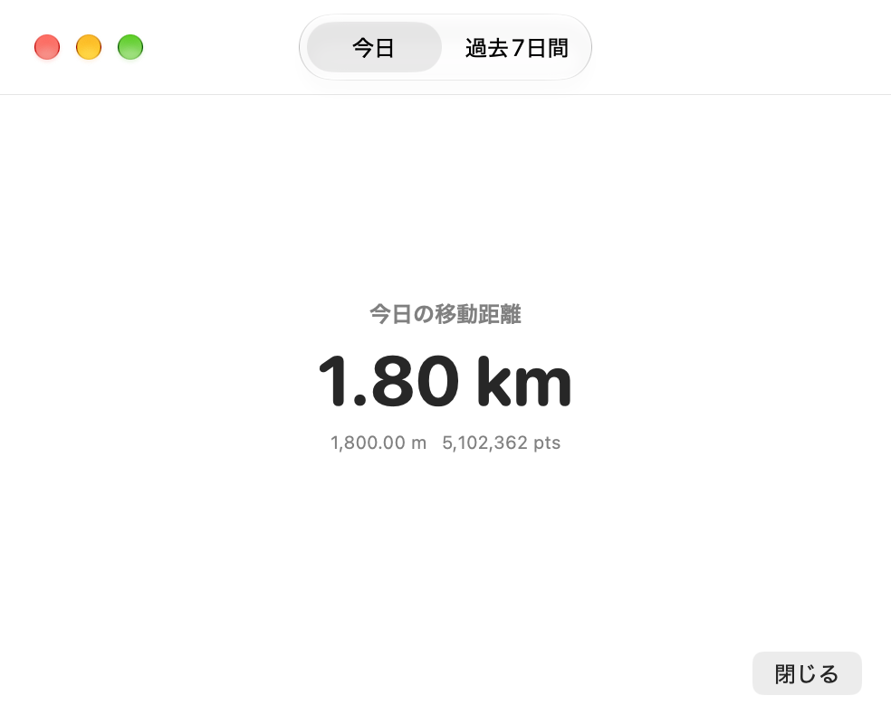
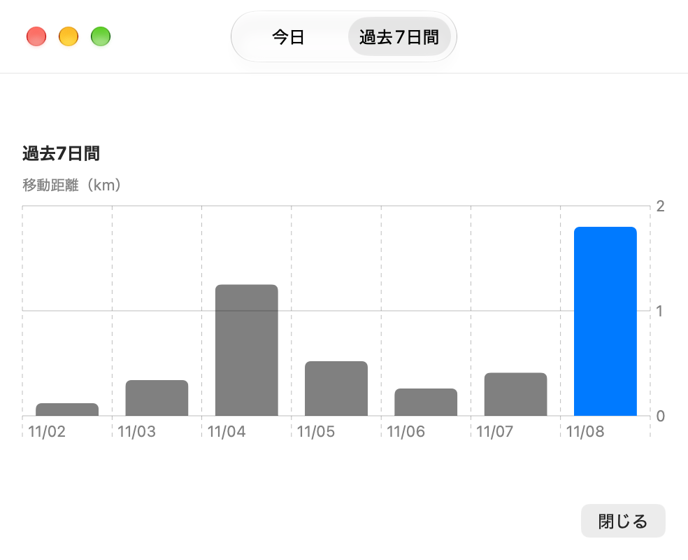

# cursor-walk

CursorWalkは、カーソルの移動距離を記録するmacOS向けのメニューバーアプリ。今日の累計距離と直近7日間の推移を確認できる。

|                                 今日                                 |                                 過去7日間                                  |
| :------------------------------------------------------------------: | :------------------------------------------------------------------------: |
|  |  |

## 機能

- マウス移動と左右ボタンでのドラッグを計測
- 今日の移動距離を cm・m・km で表示し、ポイント数も併記
- 今日を含む直近7日間の日別距離を棒グラフで表示
- グラフにポインタを重ねると日付と距離を表示
- 日別の記録をローカルに保存し、次回起動時に復元

## 動作環境

- macOS 26.0以降（現在のアプリターゲットの設定）

## インストールと起動

ビルド済みアプリは、GitHubのこのリポジトリの「Releases」から `cursor-walk-vX.Y.Z-macos-arm64.zip` をダウンロードし、展開した `CursorWalk.app` をApplicationsフォルダへ移動して起動する。

配布アプリはApple Silicon対応。Appleの公証を行っていないため、初回起動がブロックされた場合は「システム設定」→「プライバシーとセキュリティ」から起動を許可する。

起動するとメニューバーにカーソルのアイコンが表示され、自動的に計測を開始する。Dockには表示されない。

## 使い方

1. メニューバーのCursorWalkアイコンをクリックする。
2. 「今日」タブで当日の累計移動距離を確認する。
3. 「過去7日間」タブで日別の移動距離を比較する。

アプリ外の移動を取得するため、macOSの「システム設定」→「プライバシーとセキュリティ」→「アクセシビリティ」でCursorWalkを許可する。必要に応じてビルドした `CursorWalk.app` を追加し、許可後にアプリを再起動する。

計測する間はアプリを起動しておく必要がある。

## 距離の計算

画面上のカーソル座標の差から移動距離をポイント単位で求め、次の換算式で表示する。

```text
距離（m）= 移動距離（ポイント）× 0.0254 / 72
```

表示される距離は、1ポイントを1/72インチとした換算値である。ディスプレイの実寸や解像度に合わせた補正は行わないため、画面上の実際の長さや、手元のマウスを動かした距離とは異なる。

## データの保存

日付と累計ポイント数を、次のJSONファイルに保存する。

```text
~/Library/Application Support/cursor-walk/daily-distances.json
```

- 保持する履歴は今日を含む直近7日分である。
- 移動が止まってから約1秒後に自動保存する。
- カーソルの座標履歴は保存しない。外部サーバーへの送信処理もない。

UIにはSwiftUI、グラフにはSwift Charts、マウスイベントの取得にはAppKitを使用している。

## リリース手順（開発者向け）

公開したいコミットをGitHubへpushし、`vMAJOR.MINOR.PATCH` 形式のタグを付けてpushする。

```sh
git tag v1.0.0
git push origin v1.0.0
```

GitHub Actionsがアプリをビルドし、ZIPを添付したGitHub Releaseを自動公開する。
