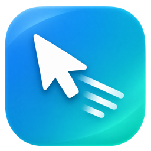
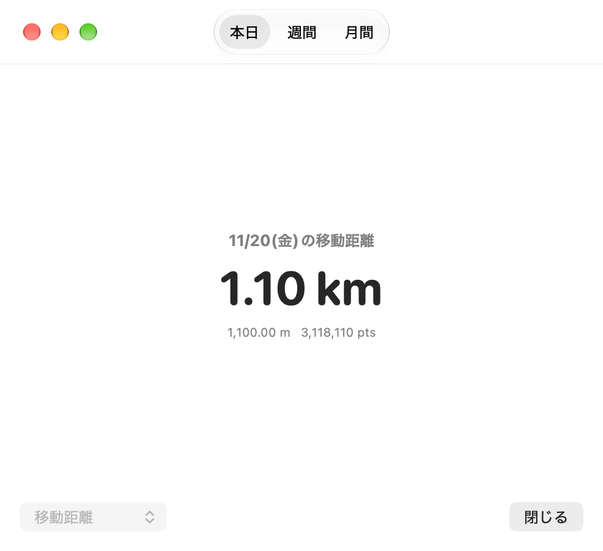
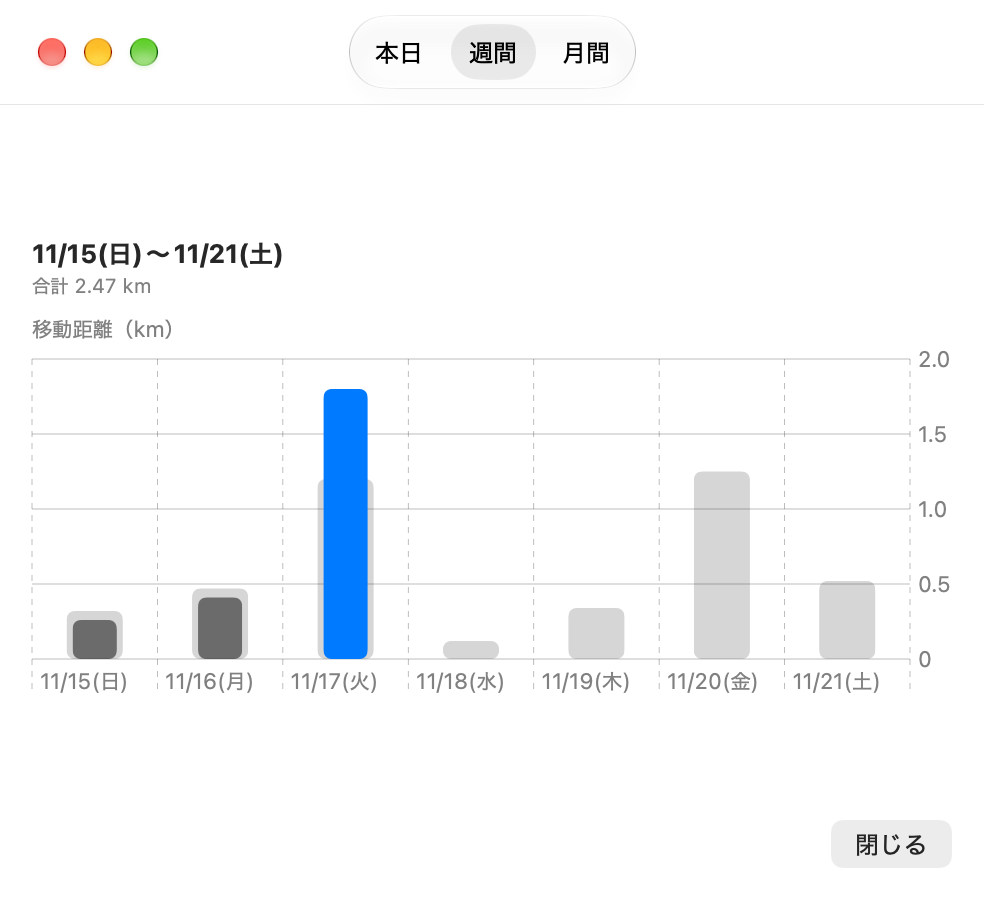

# CursorWalk

<p align="center">
  
</p>

カーソルの移動距離を記録するmacOS向けのメニューバーアプリ。本日の累計距離、今週と前週の日別推移、月ごとの移動距離を確認できる。

|                                 本日                                 |                                 週間                                  |                                      月間                                      |
| :------------------------------------------------------------------: | :-------------------------------------------------------------------: | :----------------------------------------------------------------------------: |
|  |  |  |

## 機能

- マウス移動と左右ボタンでのドラッグを計測
- 本日の移動距離を cm・m・km で表示し、ポイント数も併記
- 日曜から土曜までの今週の日別距離を、前週の同じ曜日と重ねた棒グラフで表示
- グラフにポインタを重ねると日付、距離、先週の距離、先週比を表示
- 月ごとの日別距離を、移動量に応じた濃淡のヒートマップで表示
- 月間合計を表示し、各日にポインタを重ねると日付と距離を表示
- 当月から12か月前までの月間ヒートマップを切り替えて確認
- 日別の記録を直近400日分ローカルに保存し、次回起動時に復元

## 動作環境

- macOS 26.0以降（現在のアプリターゲットの設定）
- Apple Silicon搭載Mac（配布アプリ）

## インストールと起動

1. GitHubの「Releases」で、Assetsから `cursor-walk-vX.Y.Z-macos-arm64.zip` をダウンロードして展開する。
2. 展開した `CursorWalk.app` を「アプリケーション」フォルダへ移動して起動する。

配布アプリはAppleの公証を受けていないため、初回起動がブロックされることがある。
ブロックされた場合は「システム設定」→「プライバシーとセキュリティ」から起動を許可する。

起動するとメニューバーにアイコンが表示され、自動で計測を開始する。

## 使い方

1. メニューバーのCursorWalkアイコンをクリックする。
2. 「本日」タブで当日の累計移動距離を確認する。
3. 「週間」タブで、日曜始まりの今週と前週の日別移動距離を比較する。
4. 「月間」タブで月ごとの日別移動距離を確認し、左右の矢印で表示月を切り替える。

計測する間はアプリを起動しておく必要がある。

## 距離の計算

画面上のカーソル座標の差から移動距離をポイント単位で求め、次の換算式で表示する。

```text
距離（m）= 移動距離（ポイント）× 0.0254 / 72
```

表示される距離は、1ポイントを1/72インチとした換算値である。ディスプレイの実寸や解像度に合わせた補正は行わないため、画面上の実際の長さや、手元のマウスを動かした距離とは異なる。

## データの保存

日付と累計ポイント数を、次のJSONファイルに保存する。

```text
~/Library/Application Support/cursor-walk/daily-distances.json
```

- 保持する履歴は今日を含む直近400日分である。週間グラフでは今週と前週を比較し、月間ヒートマップでは当月から過去12か月分を表示する。
- 移動が止まってから約1秒後に自動保存する。
- カーソルの座標履歴は保存しない。外部サーバーへの送信処理もない。

UIにはSwiftUI、グラフにはSwift Charts、マウスイベントの取得にはAppKitを使用している。

## リリース手順（開発者向け）

公開したいコミットをGitHubへpushし、`vMAJOR.MINOR.PATCH` 形式のタグを付けてpushする。

```sh
git tag v1.0.0
git push origin v1.0.0
```

GitHub Actionsがアプリをビルドし、ZIPを添付したGitHub Releaseを自動公開する。

## ライセンス

[MIT License](LICENSE)
