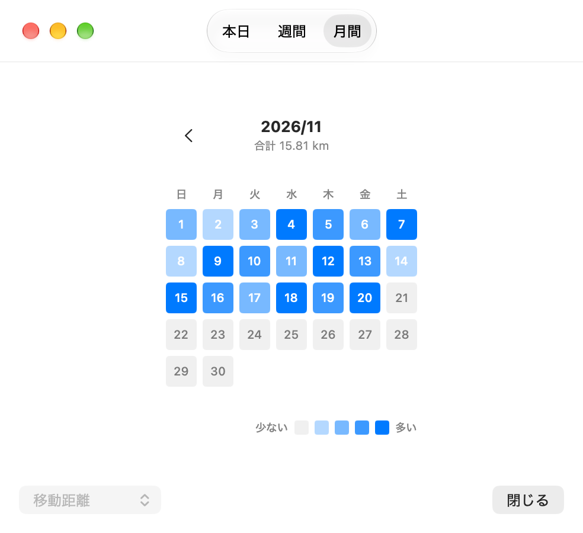

# CursorWalk

<p align="center">
  
</p>

カーソルの移動距離、マウスのクリック回数、推定スクロール回転数を記録するmacOS向けのメニューバーアプリ。本日の記録、今週と前週の日別推移、月ごとの記録を確認できる。

**移動距離の画面例**

|                                 本日                                 |                                 週間                                  |                                      月間                                      |
| :------------------------------------------------------------------: | :-------------------------------------------------------------------: | :----------------------------------------------------------------------------: |
|  |  |  |

## 機能

- カーソルの移動距離、ボタン別のクリック回数、推定スクロール回転数を計測
- 本日・週間・月間の記録を表示
- 週間グラフで今週と前週を比較
- 月間ヒートマップを過去12か月分表示
- 日別記録を直近400日分ローカルに保存

## 動作環境

- macOS 26.0以降（現在のアプリターゲットの設定）
- Apple Silicon搭載Mac（配布アプリ）

## インストールと起動

1. GitHubの「Releases」で、Assetsから `cursor-walk-vX.Y.Z-macos-arm64.zip` をダウンロードして展開する。
2. 展開した `CursorWalk.app` を「アプリケーション」フォルダへ移動して起動する。

配布アプリはAppleの公証を受けていないため、初回起動がブロックされることがある。
ブロックされた場合は「システム設定」→「プライバシーとセキュリティ」から起動を許可する。

起動するとメニューバーにアイコンが表示され、自動で計測を開始する。

## 使い方

1. メニューバーのCursorWalkアイコンをクリックする。
2. 画面左下のメニューで「移動距離」「クリック回数」「推定スクロール回転数」のいずれかを選ぶ。
3. 「本日」「週間」「月間」タブで記録を確認する。

計測する間はアプリを起動しておく必要がある。

## 指標の算出

### カーソルの移動距離

画面上のカーソル座標の差から移動距離をポイント単位で求め、次の換算式で表示する。

```text
距離（m）= 移動距離（ポイント）× 0.0254 / 72
```

表示される距離は、1ポイントを1/72インチとして紙面上の長さに換算した値である。ディスプレイ上の物理的な長さや、手元のマウスを動かした距離を表すものではない。

### 推定スクロール回転数

推定スクロール回転数は、一般的なホイールを想定し、次の値を基準に算出する。

- 1回転あたり24刻み（[BenQ ZOWIE Cシリーズの公開仕様](https://zowie.benq.com/en-us/news/2021/EC3-C.html)）
- 1刻みあたり3行（[Microsoftのマウス入力ドキュメントで使用される既定値](https://learn.microsoft.com/en-gb/windows/win32/inputdev/about-mouse-input)）
- 1行あたりのピクセル数は、イベントソースの`pixelsPerLine`を使用する。取得できない場合は、Appleが示す既定値の約10ピクセルを使用する（[AppleのCore Graphicsドキュメント](https://developer.apple.com/documentation/coregraphics/cgeventsource/pixelsperline)）

```text
行相当量 = スクロール入力のピクセル差分 ÷ pixelsPerLine
推定ホイール刻み数 = 行相当量 ÷ 3行
推定スクロール回転数（回転）= 推定ホイール刻み数 ÷ 24刻み
```

macOSのスクロール入力がホイール1刻みあたり何行に相当するかは、Appleの公開情報では確認できない。そのため、表示される回転数は1刻みを3行と仮定した推定値である。

## データの保存

移動距離の日付と累計ポイント数、クリック回数の日付とボタン別の内訳、スクロールの日付と累計行相当量を、それぞれ次のJSONファイルに保存する。推定スクロール回転数への換算は表示時に行う。

```text
~/Library/Application Support/cursor-walk/daily-distances.json
~/Library/Application Support/cursor-walk/daily-clicks.json
~/Library/Application Support/cursor-walk/daily-scroll-inputs.json
```

- 保持する履歴は今日を含む直近400日分である。週間グラフでは今週と前週を比較し、月間ヒートマップでは当月から過去12か月分を表示する。
- 移動、クリック、スクロールの操作が止まってから約1秒後に、該当する記録を自動保存する。
- カーソルの座標履歴は保存しない。外部サーバーへの送信処理もない。

UIにはSwiftUI、グラフにはSwift Charts、マウスイベントの取得にはAppKitを使用している。

## リリース手順（開発者向け）

公開したいコミットをGitHubへpushし、`vMAJOR.MINOR.PATCH` 形式のタグを付けてpushする。

```sh
git tag v1.0.0
git push origin v1.0.0
```

GitHub Actionsがアプリをビルドし、ZIPを添付したGitHub Releaseを自動公開する。

## ライセンス

[MIT License](LICENSE)
